# Quadrotor Autonomy

### [MEAM 6200 - Advanced Robotics](https://www.grasp.upenn.edu/) &nbsp;·&nbsp; University of Pennsylvania

**Bokang Ding**

[[`Hardware Demo`](https://www.youtube.com/watch?v=RspN1aLR46o)] [[`Results`](#results)] [[`Sim-to-Real`](#sim-to-real-hardware-experiments)] [[`Quickstart`](#quickstart)] [[`Code Structure`](#code-structure)]

A complete autonomy stack that lets a quadrotor plan its own route, fly it, and keep track of where it is using only an onboard stereo camera and IMU. Written in Python, it combines a **geometric SE(3) controller**, a **minimum-snap trajectory planner**, and **stereo visual-inertial odometry (VIO)**. In simulation, the drone flies three cluttered 3D courses at up to **6 m/s** with **no collisions**, steering strictly by its own state estimate rather than ground truth. An earlier version of the planning and control pipeline was also flight-tested on a real **Crazyflie 2.0**.

<p align="center">
  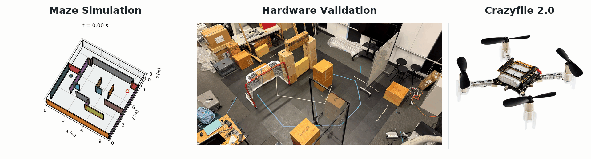
</p>

## Approach

### Geometric SE(3) Control ([`se3_control.py`](algorithms/se3_control.py))

The controller turns the planned trajectory into thrust and attitude commands. Operating directly on `SO(3)` rotations instead of Euler angles avoids gimbal-lock singularities in steep maneuvers, while jerk and yaw-rate feedforward let the drone anticipate sharp turns rather than only react to error.

### Minimum-Snap Trajectory Generation ([`world_traj.py`](algorithms/world_traj.py), [`graph_search.py`](algorithms/graph_search.py))

A\* search finds a collision-free route through a 3D voxel map, keeping as much obstacle clearance (`0.45` down to `0.26 m`) as each course allows, and line-of-sight pruning reduces it to sparse waypoints. Because the minimum-snap optimum is `C⁶`-continuous at interior waypoints, the 7th-order polynomials are solved in closed form as a single `8n×8n` linear system, with no QP solver. Segment times are refined by projected gradient descent, then scaled by bisection to the fastest timing that respects the `6 m/s` speed cap and per-rotor thrust limits (`88%` of max) derived from differential flatness. Any segment that clips an obstacle is repaired.

### Stereo Visual-Inertial Odometry ([`vio.py`](algorithms/vio.py))

An 18-state error-state Kalman filter fuses IMU kinematics with stereo feature tracks to estimate position, velocity, orientation, sensor biases, and gravity. Outlier matches are rejected by innovation gating, and the covariance is updated in Joseph form for numerical stability.

## Results

All three courses are completed with no collisions and no motor saturation (`5.6%-21.6%` rotor speed headroom). Tracking error is the RMS distance between true and reference position; VIO error is the RMS error of the onboard state estimate against ground truth.

| Course | Distance (m) | Flight time (s) | Top speed (m/s) | Peak tilt | Tracking error (m) | VIO error (m) |
| :-- | :-: | :-: | :-: | :-: | :-: | :-: |
| **Maze** | 24.2 | 7.2 | 6.0 | 43.5° | 0.048 | 0.039 |
| **Window** | 24.5 | 7.0 | 6.0 | 22.6° | 0.084 | 0.082 |
| **Over-Under** | 33.2 | 12.4 | 4.2 | 18.8° | 0.045 | 0.042 |

- **What limits speed.** On Maze and Window the drone runs into the `6 m/s` speed cap. On Over-Under, steep climbs hit the thrust limit first: peak rotor thrust reaches `89%` of maximum, just above the `88%` planning budget.
- **Where the error comes from.** Measured against its own state estimate, the controller tracks the reference to within `0.006-0.021 m` RMS, so most of the remaining error is drift in the mapless camera estimate. Flying more precisely here is an estimation problem more than a control problem.

### Maze

Full-speed flight through the maze corridors, banking up to 43.5° and pulling close to 1 *g* in the turns.

| Flight | Tracking Error | Planned Trajectory |
| :-: | :-: | :-: |
| 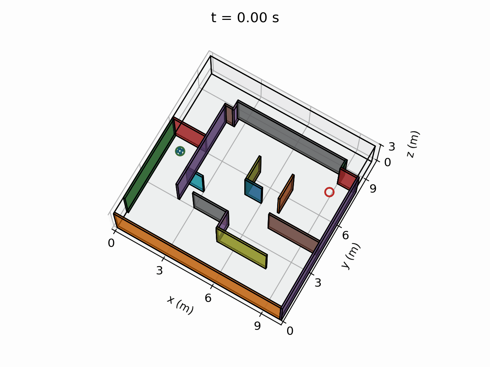 | 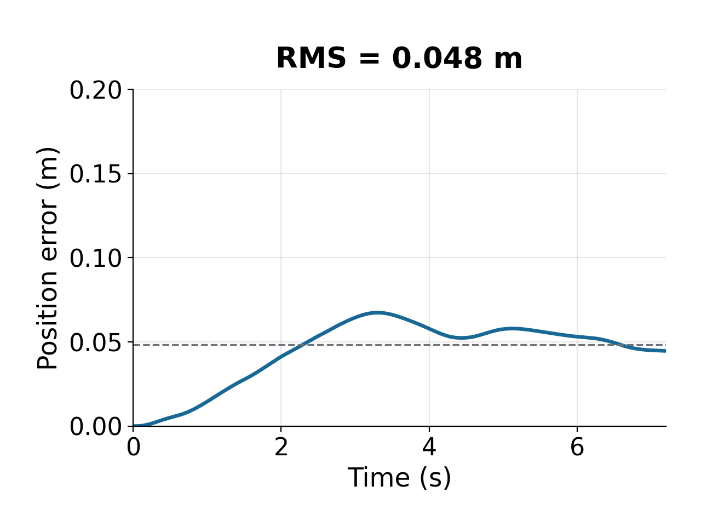 | 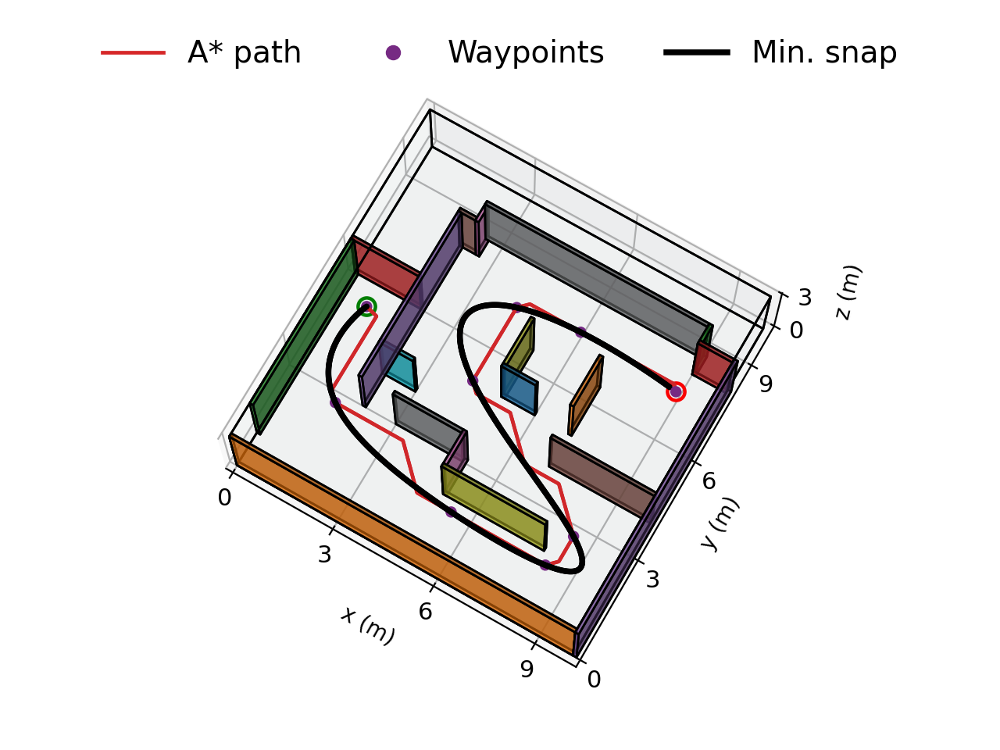 |

### Window

The drone threads the window opening with under 0.02 m of error. On the long, open stretch that follows, the camera sees few features, the position estimate slowly drifts, and tracking error grows to 0.18 m by the goal.

| Flight | Tracking Error | Planned Trajectory |
| :-: | :-: | :-: |
| 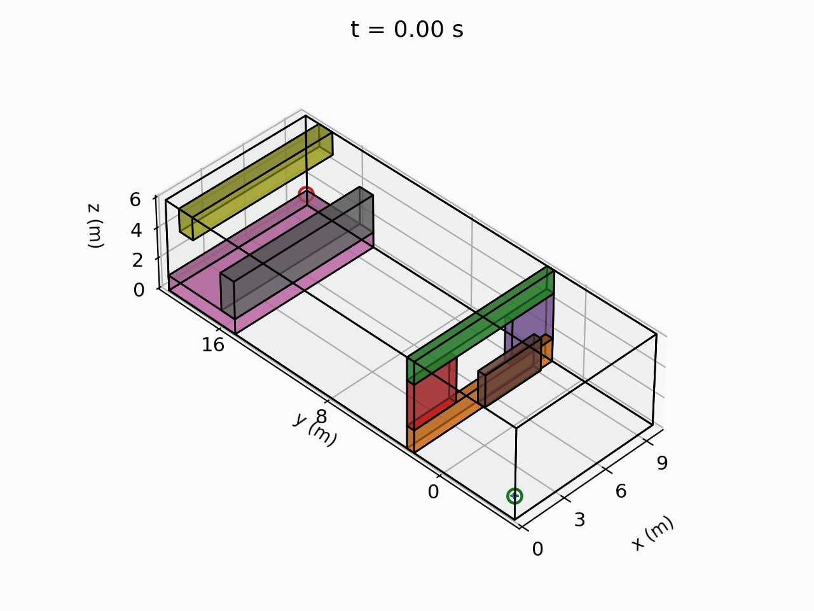 | 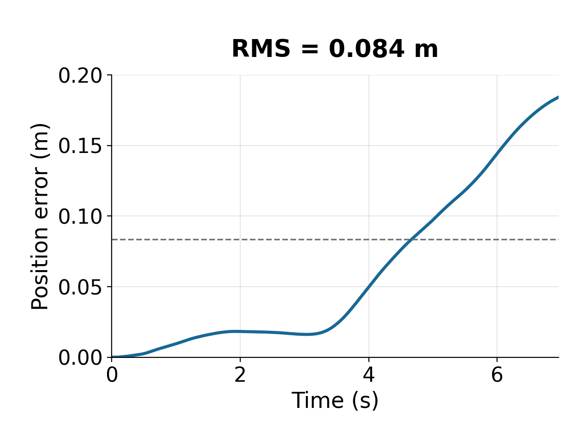 | 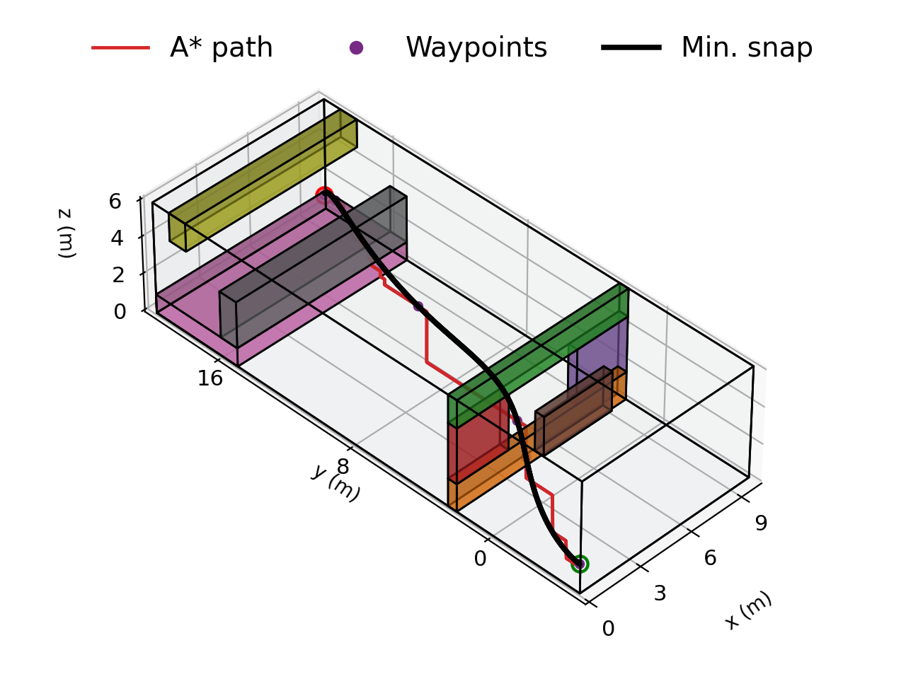 |

### Over-Under

Climbing over and diving under obstacles. Here the motors' thrust limit, not the speed limit, sets the pace.

| Flight | Tracking Error | Planned Trajectory |
| :-: | :-: | :-: |
| 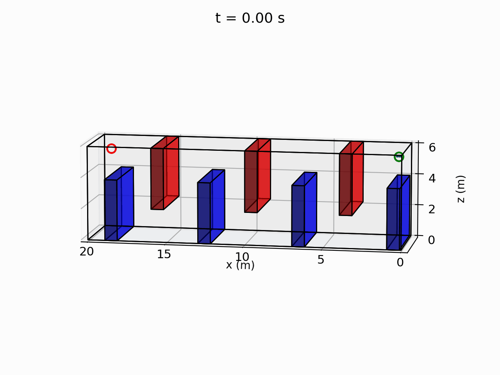 | 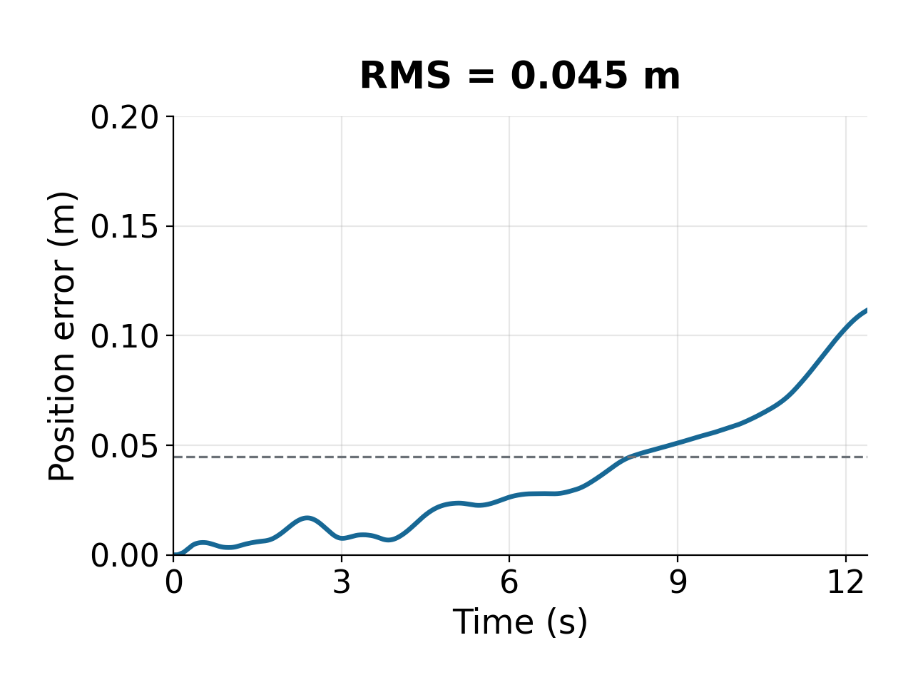 | 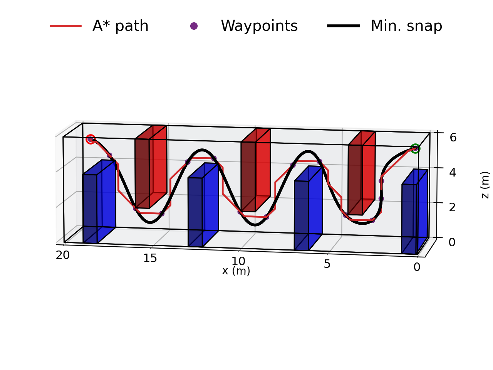 |

## Sim-to-Real Hardware Experiments

In a team lab for the same course, an earlier version of the planning and control pipeline, running offboard on a ground station, flew a real **Crazyflie 2.0** nano-quadrotor in a **VICON** motion-capture arena, with motion capture providing state feedback in place of onboard VIO. The drone completed all three physical mazes without collision.

<p align="center">
  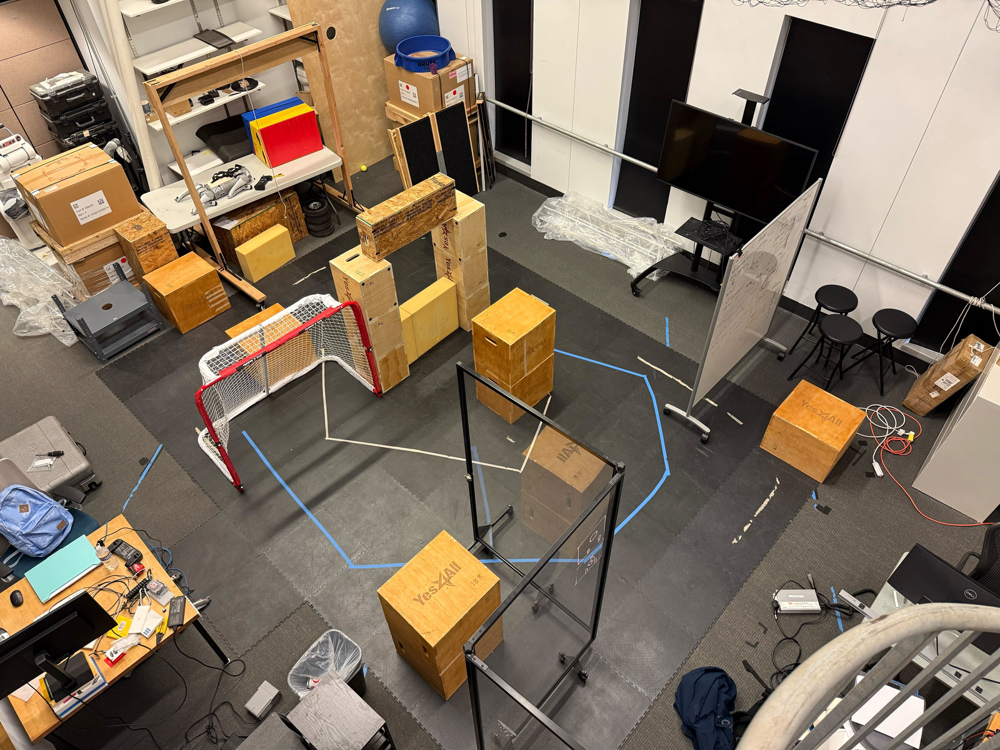
  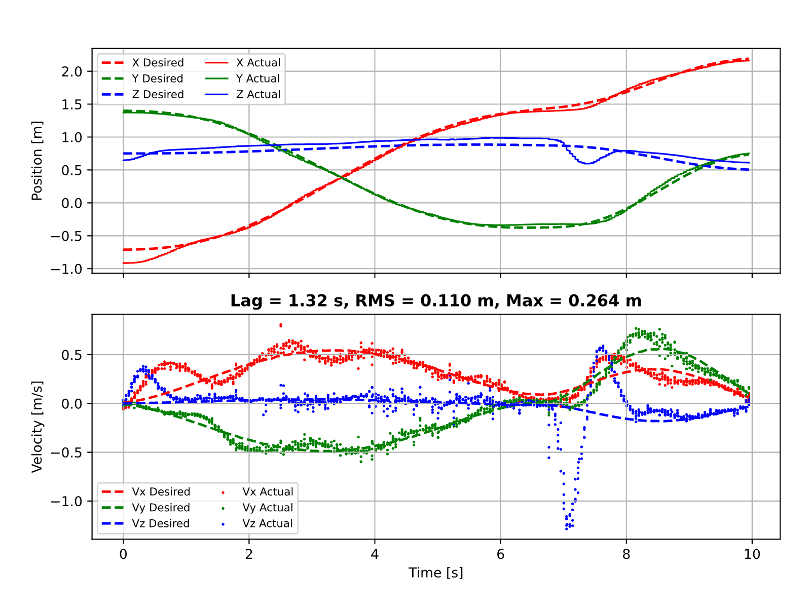
  <br>
  <b>Fig. 1.</b> Left: the VICON flight arena (<em><a href="https://www.youtube.com/watch?v=RspN1aLR46o">click to watch the hardware flight video</a></em>). Right: commanded vs. flown position and velocity on Map 2.
</p>

<p align="center">
  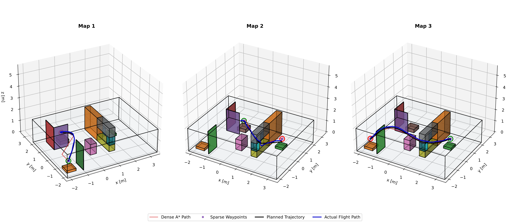
  <br>
  <b>Fig. 2.</b> Planned and flown paths on the three physical mazes.
</p>

- **Simulation gains don't transfer.** Motor lag, battery sag, and aerodynamics meant the gains had to be retuned on the real drone. Altitude step tests showed 1-2 s of oscillation and a steady offset that never appear in the rigid-body simulator.
- **Real tracking error sets the safety margin.** In simulation the controller tracks its own state estimate to within about 0.02 m, even at 6 m/s. On the real drone, with near-perfect motion-capture state and below 1 m/s, it still strayed about 0.11 m from the path on average and 0.26 m at worst. How much clearance to leave around obstacles has to come from real flight data, not from simulation.

## Quickstart

Requires **Python 3.8** in a virtual environment:

```bash
git clone https://github.com/bkding/quadrotor.git
cd quadrotor
python3.8 -m venv .venv
source .venv/bin/activate        # Windows: .venv\Scripts\activate
pip install -e .
```

**Single mission** (plots and a live animation for one course; set `filename` in `sandbox.py` to switch courses):

```bash
python sandbox.py
```

**Full benchmark suite:**

```bash
python tests/test.py
```

## Code Structure

```text
.
├── algorithms                       # Core autonomy stack
│   ├── se3_control.py               #   Geometric SE(3) controller
│   ├── world_traj.py                #   Minimum-snap trajectory generation & time scaling
│   ├── graph_search.py              #   3D A* / Dijkstra voxel search
│   ├── vio.py                       #   18-state ESKF for stereo VIO
│   └── occupancy_map.py             #   Voxel grid & obstacle inflation
├── flightsim                        # Course simulator, dynamics, & sensor models
├── tests                            # Evaluation harness and JSON benchmark maps
├── sandbox.py                       # Single-mission entrypoint & plotting
└── setup.py
```

## Acknowledgements

`flightsim`, `occupancy_map.py`, and the evaluation harness were provided by the **MEAM 6200** course staff at the University of Pennsylvania (see [`flightsim/LICENSE.md`](flightsim/LICENSE.md)). All other implementations in `algorithms/` are my own individual work; the VICON hardware experiments were conducted jointly with Qihan Shan, Carlos Vega, and Bruce Zhang.

> **Note for Penn Students:** Published as a portfolio artifact. If you are enrolled in MEAM 6200, please do not copy code from this repository.
